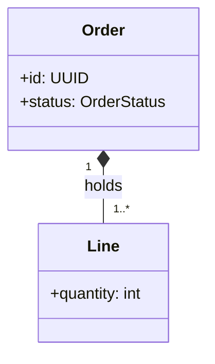

# Short title of the structure

The rule in one to three sentences: which part of the code must agree with the diagram. Use
`must` and `must not`.

## Diagram

## Elements

| Element | Path | Meaning |
| --- | --- | --- |
| `Order` | - | One order of one customer. |
| `Line` | - | One product and its quantity in an order. |

Reason: The cause of the rule.

Test: The test or the review that finds a difference between the code and the diagram.
