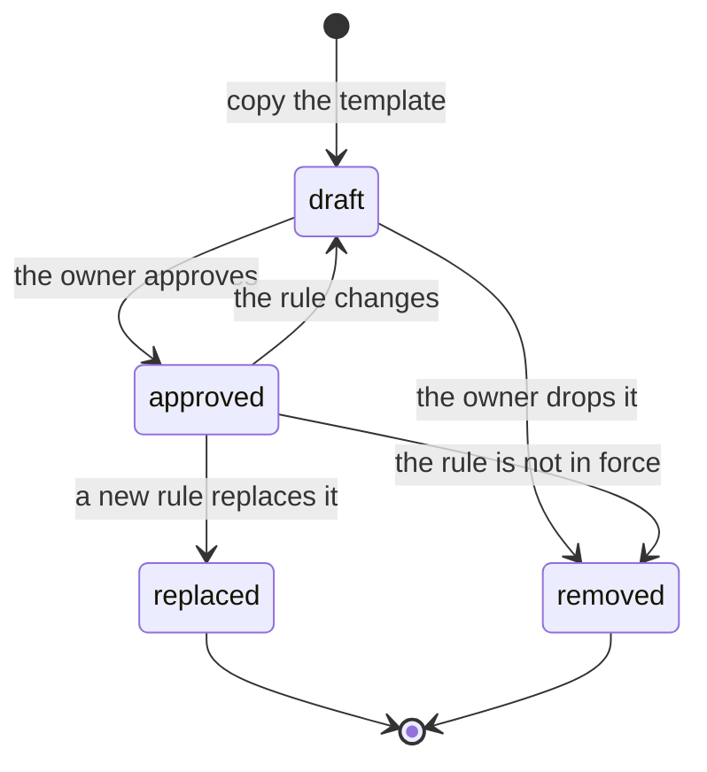

# The status of a spec moves from draft to approved, replaced or removed

A spec must change its status only along an arrow of this diagram. A spec with `replaced` or
`removed` must not go back to `draft` or `approved`. A change of that rule must get a new spec
with a new number (000013).

## Diagram

## Elements

| Element | Path | Meaning |
| --- | --- | --- |
| `draft` | specs/TEMPLATE.md | The owner did not approve the spec yet. |
| `approved` | specs/style/specs/format/000010_status.md | The owner approved the spec. |
| `replaced` | specs/style/specs/format/000010_status.md | A different spec, named in `replaced_by`, replaces the spec. |
| `removed` | specs/style/specs/format/000010_status.md | The spec is not in force. The number stays taken. |

Reason: A number is never used again (000013). The diagram shows that a spec that left force
stays out of force.

Test: Review.
