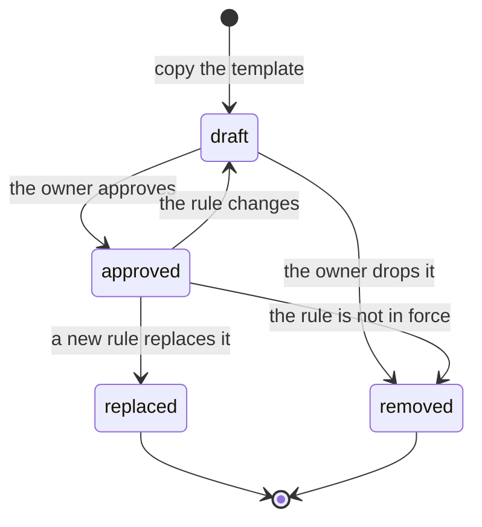

# The status of a spec moves from draft to approved, replaced or removed

The status of a spec must change only along an arrow of this diagram.

## Diagram

## Elements

| Element | Path | Meaning |
| --- | --- | --- |
| `draft` | specs/.templates/TEMPLATE.md | The owner did not approve the spec yet. |
| `approved` | specs/conventions/specs/format/000010_status.md | The owner approved the spec. |
| `replaced` | specs/conventions/specs/format/000010_status.md | A different spec replaces the spec and names it in `replaces`. `replaced_by` names that spec. |
| `removed` | specs/conventions/specs/format/000010_status.md | The spec is not in force. The number stays taken. |

Reason: Each arrow is one step that the owner can examine.

Test: Review.
