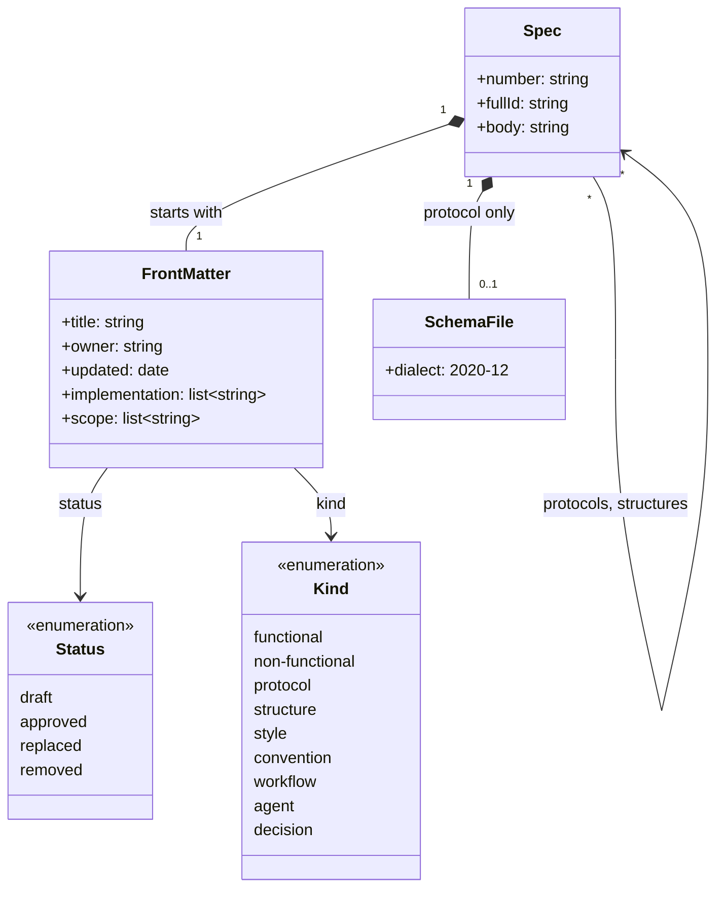

# A spec has a front matter, a body and links to other specs

The class `Spec` in `scripts/check_specs.py` and the keys of the templates must agree with this
diagram. A new key of the front matter must change the diagram and 000009 in the same pull
request.

## Diagram

## Elements

| Element | Path | Meaning |
| --- | --- | --- |
| `Spec` | scripts/check_specs.py | One spec file with its number, its full rule ID and its Markdown body. |
| `FrontMatter` | specs/TEMPLATE.md | The YAML block at the start of a spec file (000009). |
| `Status` | specs/conventions/specs/format/000010_status.md | The approval state of a spec (000010). |
| `Kind` | specs/conventions/specs/layout/000004_tree.md | The type of a spec, given by its kind folder (000004). |
| `SchemaFile` | specs/TEMPLATE-protocol.md | The JSON Schema beside a protocol spec of a JSON format (000028). |

Reason: The diagram shows in one view how the parts of a spec and the links between specs fit
together.

Test: Review. `scripts/check_specs.py` checks the keys of 000009.
